<h1 align="center">
  <picture>
    <source media="(prefers-color-scheme: dark)" srcset="assets/logo/mira-wordmark-dark.svg">
    
  </picture>
</h1>

<p align="center">
  A lightweight BSPWM desktop for Debian 13 (trixie) with five themes, five Polybar layouts,
  live 3px ordered-Bayer GLSL wallpapers, and a matching Qt 6 SDDM theme.
</p>

Mira is a set of dotfiles and native tools for a BSPWM session on X11. Its modular session layout
(themes, bars, pickers, soft reload) is adapted from
[gh0stzk/dotfiles](https://github.com/gh0stzk/dotfiles), while the visual design, themes, Polybar
layouts, SDDM greeter, showcase site (`docs/`), and native Rust & C components are written for this
repository.

> [!NOTE]
> Mira targets Debian 13 (trixie) on X11 with BSPWM. Other distributions and window managers are
> not tested.
>
> **Model benchmark note:** This repository also serves as a practical benchmark of Google's
> **Gemini Neon** model running with **`xhigh` effort**, covering the native Rust/C tooling,
> themes, Polybar layouts, Qt 6 SDDM greeter, static showcase website (`docs/`), and all ten
> wallpapers plus the underwater login/hero scene. All wallpapers are coded deterministically
> by Gemini Neon in pure Python (`tools/walls/`) and paired with live 3px ordered-Bayer GLSL
> shaders (`*.frag`) without external image assets or image-generation models.

## Contents

- [Features](#features)
- [Memory usage](#memory-usage)
- [Screenshots](#screenshots)
- [Themes and wallpapers](#themes-and-wallpapers)
- [Polybar layouts](#polybar-layouts)
- [SDDM login theme](#sddm-login-theme)
- [Requirements](#requirements)
- [Installation](#installation)
- [Keybindings](#keybindings)
- [Customization](#customization)
- [Project layout](#project-layout)
- [Development](#development)
- [Credits](#credits)
- [License](#license)

## Features

- **Five themes and five Polybar layouts.** Switch between `Mira`, `Matcha`, `Ember`, `Fjord`, and
  `Aria` (`RiceSelector`) or mix any of the five Polybar geometries (`mira`, `mira-float`,
  `mira-islands`, `mira-line`, `mira-minimal`) via `BarSelector`.
- **Live animated shader wallpapers (`misa-wall`).** Bakes 3px ordered-Bayer GLSL fragment shaders
  once offscreen into content-hashed planar-delta `.mwa` (LZ4 + `16×9` tile dirty masks) loops,
  then plays them in a zero-OpenGL / zero-GdkPixbuf daemon (~1.8 MiB PSS active, ~0.75 MiB paused)
  using hardware `XRender` nearest-neighbor 3× scaling from a `640×360` MIT-SHM buffer, adaptive
  per-monitor occlusion FPS, and AVX2 Luma-Halftone Develop transitions. Also supports static
  images with 0 MiB resident RAM.
- **Scrolling layout (`Scroll`).** Per-desktop horizontal scrolling columns over the BSPWM Unix
  socket, alongside standard BSPWM tiling layouts (`Layout`).
- **Full-screen pickers (`CardPicker`).** GPU-dithered 1:1 thumbnails for the wallpaper gallery
  (`WallSelect`), theme showcase (`RiceSelector`), and bar strip selector (`BarSelector`).
- **Qt 6 SDDM greeter (`sddm/mira`).** Matching 4×4 pixel-dithered underwater shader background,
  architectural pixel clock (`PixelClock.qml`), five switchable palettes (`F3`), and optional
  blurred desktop wallpaper sync (`SddmBackground`).
- **App launcher.** Rofi anchored beneath Polybar, sorted by usage (`RofiLauncher`).
- **Notifications (`NotifPanel`).** Notification daemon with toasts, notification center, Do Not
  Disturb toggle, and volume/brightness OSD.
- **Clipboard history (`misa-clip` + `ClipPanel`).** Persistent text and PNG clipboard daemon and
  picker.
- **Wi-Fi and Bluetooth panels.** Network list, connection details, and Wi-Fi QR sharing
  (`WifiPanel`, `BluetoothPanel`).
- **Media & Sound.** Now-playing pill (`MediaPillUI`) plus native GTK 3 music (`MusicPanel`) and
  sound (`SoundPanel`) popups (one-shot, 0 MiB idle RAM).
- **Window switcher & backdrop.** Live-thumbnail Alt-Tab switcher (`WindowSwitch`) and popup blur/dim
  layer with passive Escape grab (`misa-backdrop`).
- **Showcase website (`docs/`).** Static site mirroring the five themes, Polybar layouts, WebGL
  3px Bayer shaders, and pickers in the browser.

All Rust daemons (`misa-wall`, `misa-scroll`, `misa-clip`, `misa-backdrop`) have zero external
crates (`std` only) and build offline; UI overlays (`misa-ui`) are written in C with GTK 3.

## Memory usage

At idle on an empty `:0` desktop (0 windows open, animated 3px Bayer shader wallpaper active in
`misa-wall` v3, with `bspwm`, `sxhkd`, `picom`, `polybar`, and all Mira daemons running), the
session uses **~129 MiB PSS** (`128.6 MiB` after replacing Eww with one-shot GTK 3 `SoundPanel` &
`MusicPanel` and upgrading `misa-wall` to zero-OpenGL `XRender` + `pread` MWA3 streaming at
`~1.8 MiB` active / `~0.75 MiB` paused).

<details>
<summary>Per-component idle PSS breakdown (2026-11-25, 0 open windows)</summary>

```text
Mira memory (PSS) on :0, 2026-11-25
theme: mira · bar: mira-float · wall: live MWA3 XRender daemon · open windows: 0

component        procs  PSS (MiB)
picom                1       39.4
ClipPanel            1       34.6
polybar              2       17.2
NotifPanel           1       13.3
WifiPanel            1       12.0
misa-clip            1        2.6
misa-wall            1        1.8
MonitorWatch         2        1.3
playerctl            1        1.3
Scroll               1        1.3
xev                  1        1.1
bspwm                1        0.6
xsettingsd           1        0.5
sxhkd                1        0.4
bspwmrc / helpers    8        1.2
TOTAL                       128.6
```

Measure it on your own machine with `./tools/memory-bench.sh -n 5`.

</details>

## Screenshots

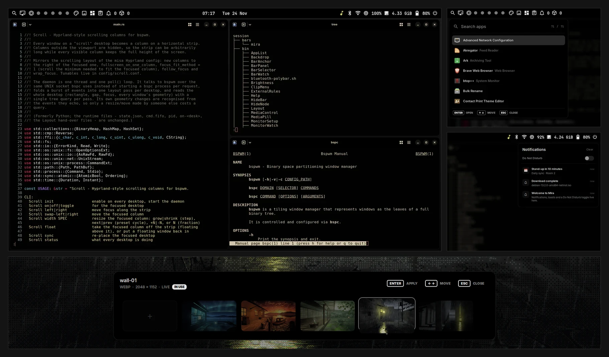

| Scrolling layout | App launcher |
| :---: | :---: |
| 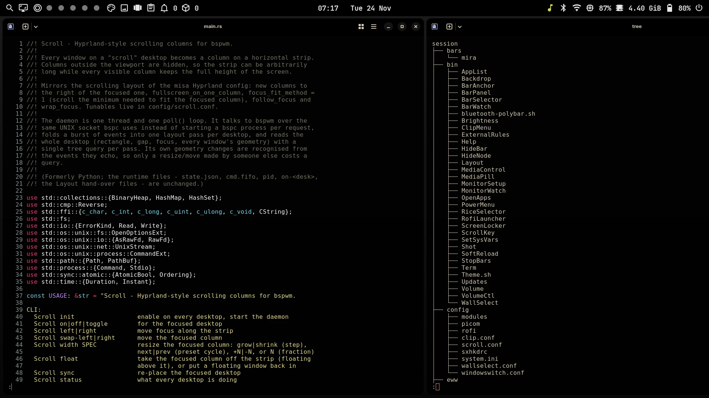 | 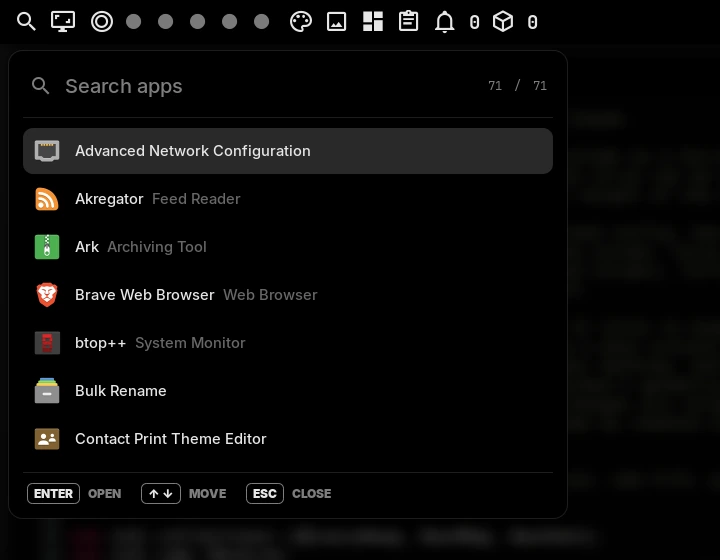 |
| **Wallpaper picker (`WallSelect`)** | **Theme picker (`RiceSelector`)** |
| 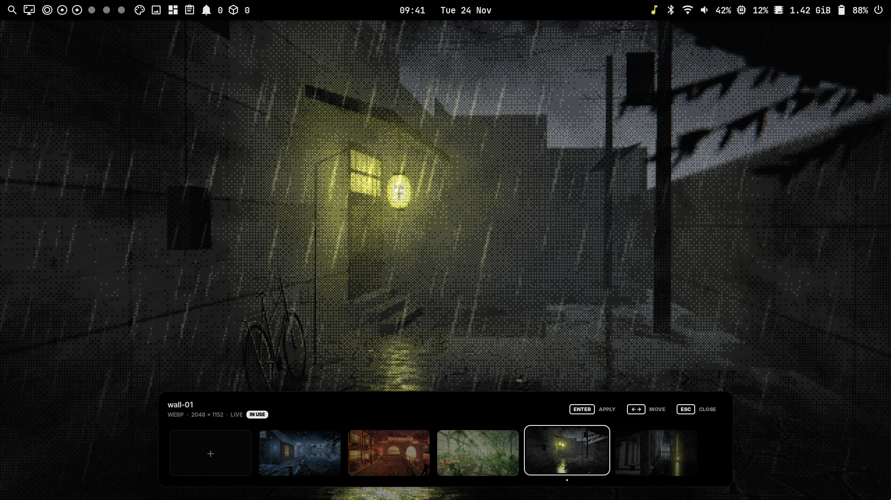 | 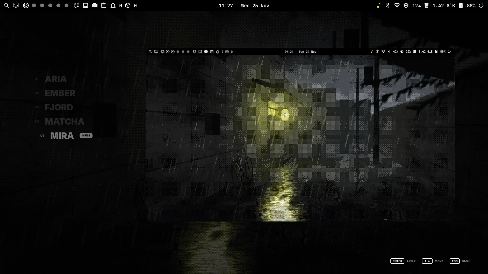 |
| **Notification center (`NotifPanel`)** | **Clipboard history (`ClipPanel`)** |
| 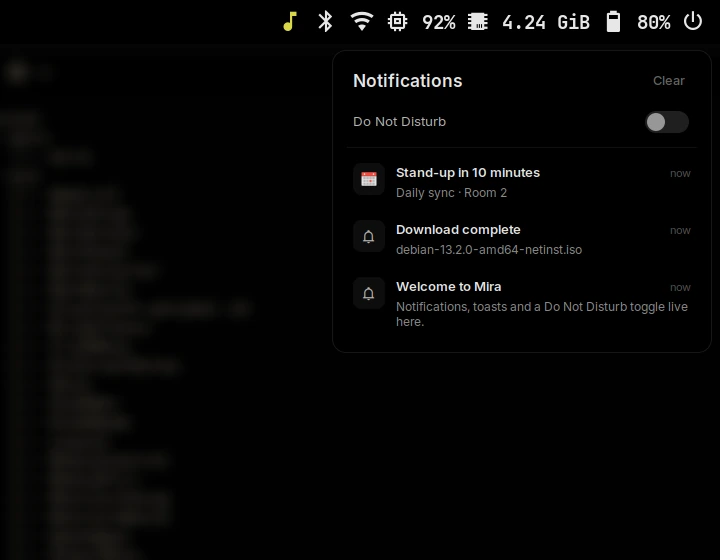 | 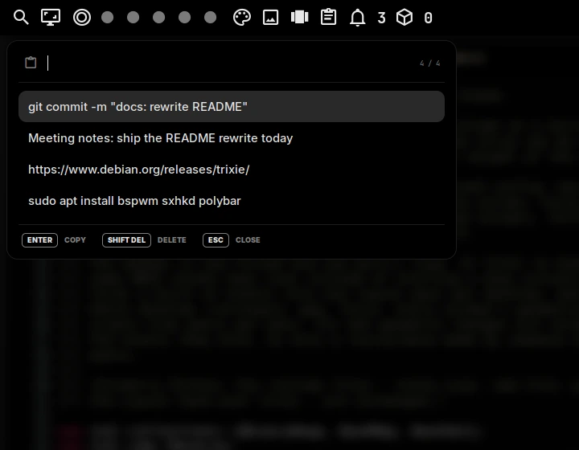 |

### SDDM login screen

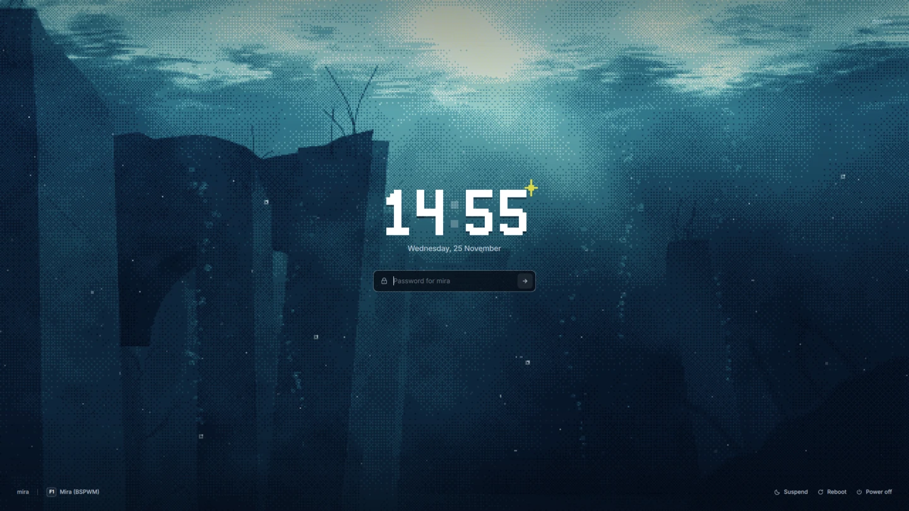

## Themes and wallpapers

Mira ships with five themes and ten bundled wallpapers (`session/themes/<theme>/walls/wall-0{1,2}.webp`
+ `.frag`). Each base scene is generated deterministically in pure Python (`tools/walls/paint_*.py`,
written by Gemini Neon with `xhigh` effort) and rendered live on the desktop through a 3px
ordered-Bayer GLSL shader in `misa-wall`.

| Theme | Palette & default bar | `wall-01` (live shader) | `wall-02` (live shader) |
| --- | --- | :---: | :---: |
| **Mira** | Monochrome obsidian · `#d9d84a` · `mira` | 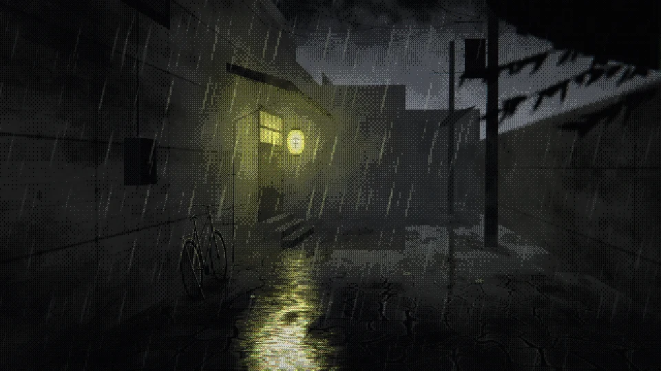 | 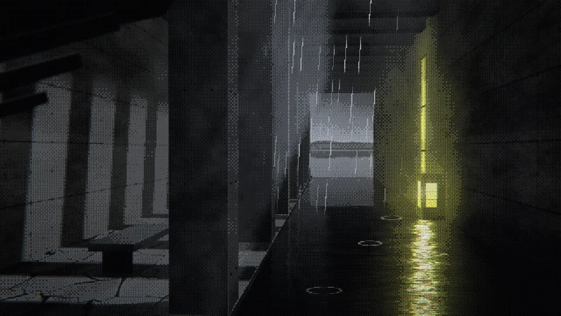 |
| **Matcha** | Mossy charcoal · `#b8cc7a` · `mira-islands` | 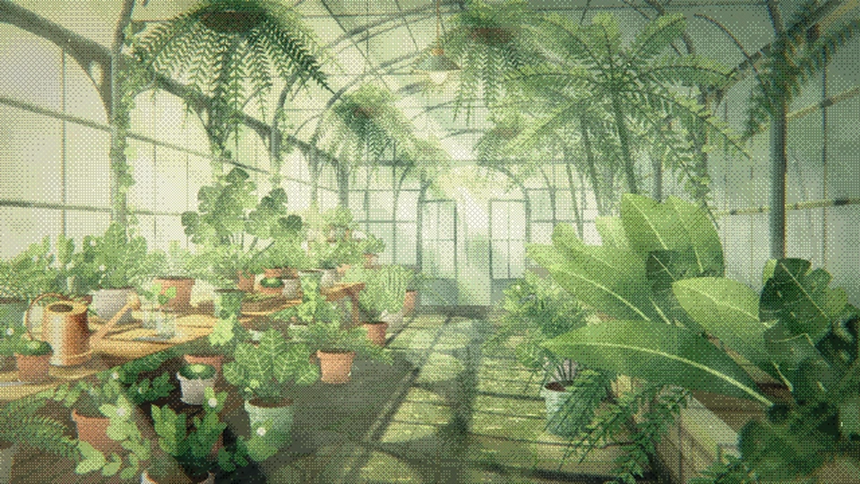 | 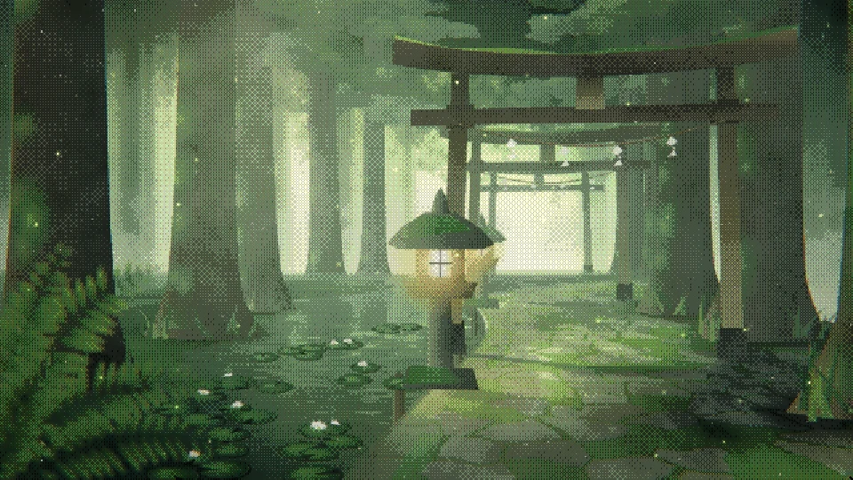 |
| **Ember** | Volcanic obsidian · `#f07148` · `mira-line` | 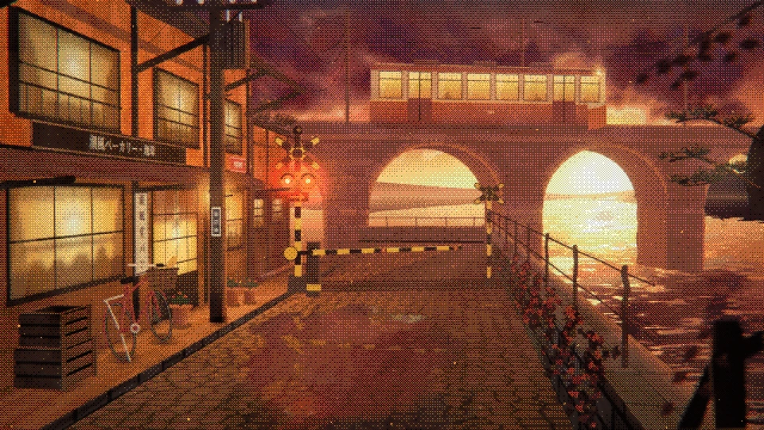 | 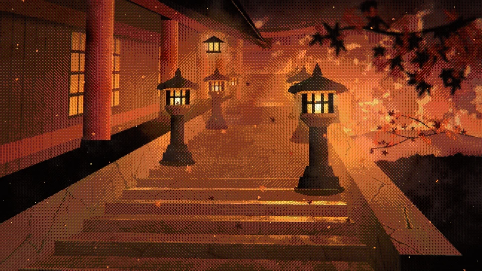 |
| **Fjord** | Basalt slate · `#8db7d4` · `mira-minimal` | 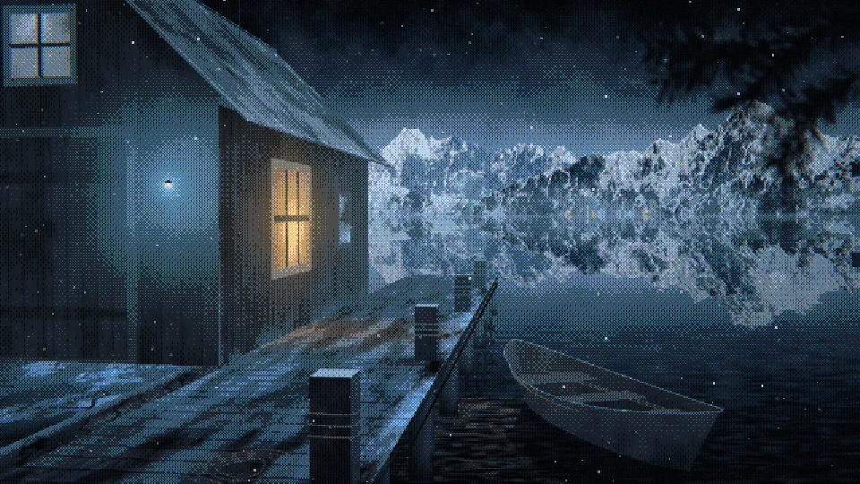 | 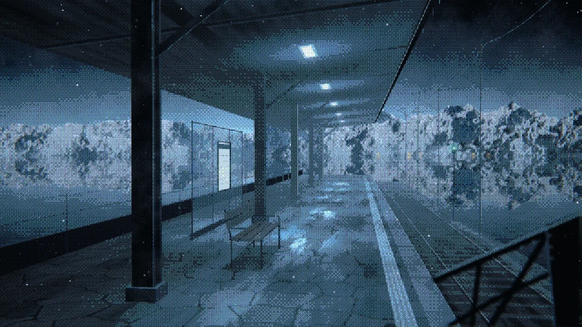 |
| **Aria** | Midnight navy · `#5ce6b8` · `mira-float` | 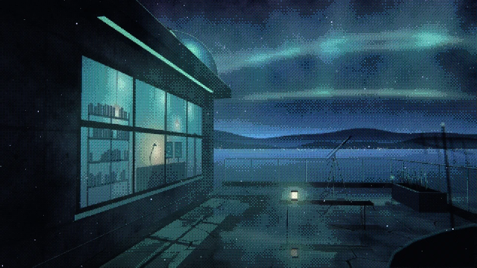 | 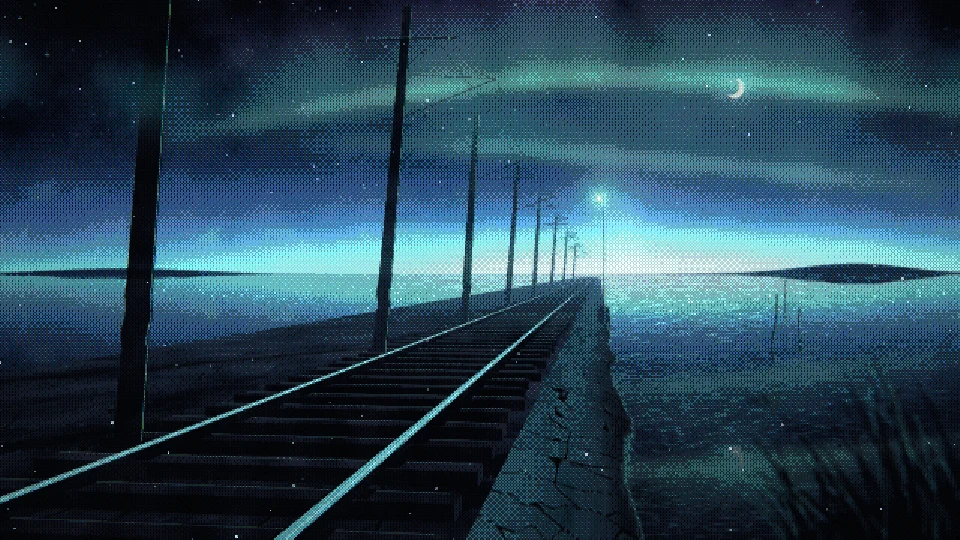 |

You can also add your own static wallpapers with the `+` tile in `WallSelect` (`Super + Alt + W`),
or copy them to `~/Pictures/Wallpapers`.

## Polybar layouts

Press `Super + Alt + Space` (`BarSelector`) to switch layouts live without restarting the session:

| Layout | Preview |
| --- | --- |
| `mira` | 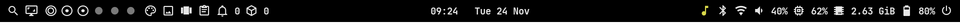 |
| `mira-float` | 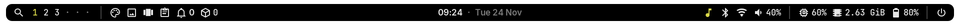 |
| `mira-islands` | 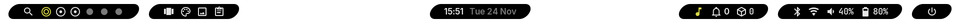 |
| `mira-line` | 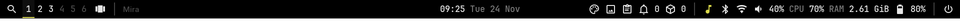 |
| `mira-minimal` | 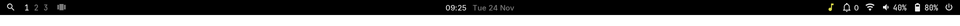 |

## SDDM login theme

The Qt 6 SDDM theme lives in `sddm/mira/` and uses the same pixel-dithered underwater shader as the
landing page (`docs/`).

- `F1` / `Shift + F1`: cycle session
- `F2` / `Shift + F2`: cycle user
- `F3` / `Shift + F3`: cycle palette (`Mira`, `Matcha`, `Ember`, `Fjord`, `Aria`)
- Optional blurred desktop wallpaper sync: set `useDesktopWallpaper=true` in
  `/usr/share/sddm/themes/mira/theme.conf` (`session/bin/SddmBackground` updates
  `/var/lib/mira-sddm/background.jpg` whenever you change wallpapers).

Install or remove it with:

```sh
sudo ./tools/sddm-theme.sh
# or revert to the system default:
sudo ./tools/sddm-theme.sh --remove
```

## Requirements

- Debian 13 (trixie) with an X11 session and SDDM
- Packages installed by [`tools/setup.sh`](tools/setup.sh): `bspwm`, `sxhkd`, `picom`, `polybar`,
  `rofi`, `feh`, `maim`, `xclip`, `slop`, `xxhash`, `wmctrl`, `i3lock`, `xserver-xephyr`,
  `imagemagick`, `jq`, `playerctl`, `brightnessctl`, `qrencode`, `cargo`, `build-essential`,
  GTK 3 and X11 development headers, and session utilities

Not packaged in Debian 13, install separately:

| Program | Used for |
| --- | --- |
| [Ghostty](https://ghostty.org) | Default terminal |
| [JetBrainsMono Nerd Font](https://www.nerdfonts.com) | Bar and terminal font |
| [yazi](https://github.com/sxyazi/yazi) | File manager and `xdg-desktop-portal` file chooser (optional) |
| x-shot | Screenshot overlay (optional; `build.sh` builds it from a sibling `../x-shot` checkout) |

## Installation

```sh
git clone https://github.com/misaalya/mira.git
cd mira

# 1. Install Debian 13 packages, touchpad defaults, and the "Mira (BSPWM)" SDDM session
sudo ./tools/setup.sh

# 2. Build native Rust (offline, 0 crates) and C/GTK 3 tools into ./build/bin
./tools/build.sh

# 3. Optional: test an isolated session in Xephyr (:9) without touching ~/.config
./tools/dev-session.sh

# 4. Deploy into ~/.config/bspwm (also installs bundled fonts & portal config)
./tools/deploy.sh

# 5. Optional: install the Mira Qt 6 SDDM login theme
sudo ./tools/sddm-theme.sh
```

Log out and select **Mira (BSPWM)** in SDDM.

`deploy.sh` validates the picom configuration before syncing and can be re-run safely after
updates. It preserves your active theme, bar, hardware settings, and custom wallpapers while
updating built-in scripts, binaries, and theme shaders.

## Keybindings

Press `Alt + F1` for the full cheatsheet (`session/config/sxhkdrc`).

| Keys | Action |
| --- | --- |
| `Super + Return` | Terminal |
| `Super + Alt + Return` | Floating terminal |
| `Super + Space` | App launcher |
| `Alt + Space` | Theme picker (`RiceSelector`) |
| `Super + Alt + Space` | Bar picker (`BarSelector`) |
| `Super + Alt + W` | Wallpaper picker (`WallSelect`) |
| `Super + Alt + N` / `B` | Wi-Fi / Bluetooth panel |
| `Super + Alt + C` | Clipboard history (`ClipPanel`) |
| `Super + Alt + D` | Notification center (`NotifPanel`) |
| `Super + M` | Music panel |
| `Alt + Tab` | Window switcher (`WindowSwitch`) |
| `Super + Alt + Z` | Toggle scrolling columns / tiling layout |
| `Super + Alt + T` | Next tiling layout |
| `Super + Alt + ←/→/↑/↓` | Move focus |
| `Super + Shift + ←/→/↑/↓` | Swap windows |
| `Super + Ctrl + ←/→` | Resize column or window width |
| `Super + ,` / `.` | Cycle scroll column width presets |
| `Super + 1…0` | Switch to desktop 1–10 |
| `Super + X` | Close window |
| `Print` | Screenshot |
| `Super + L` | Lock screen |
| `Super + Alt + H` / `U` | Hide / show top bar |
| `Super + Alt + P` | Power menu |
| `Ctrl + Super + Alt + S` | Soft reload daemons and bar |

## Customization

- **Themes:** `session/themes/<name>/theme.conf` (palette, bar, fonts, picom, GTK, default wallpaper)
- **Live wallpapers & shaders:** `session/themes/<name>/walls/wall-*.webp` + matching `.frag` GLSL sidecar
- **Polybar layouts:** `session/bars/<name>/`
- **SDDM greeter:** `sddm/mira/theme.conf` (default palette, cell size, desktop wallpaper sync)
- **Keybindings:** `session/config/sxhkdrc`
- **Picom rules & animations:** `session/config/picom/`

Edit files in this repository and run `./tools/deploy.sh` to apply them.

## Project layout

```text
src/       Native tools: misa-scroll, misa-wall, misa-clip, misa-backdrop (Rust, 0 crates),
           misa-ui (C, GTK 3 + GLX live thumbnail renderer)
session/   BSPWM session: bspwmrc, sxhkdrc, 5 themes + 10 live wallpapers, 5 Polybar layouts,
           rofi configs, picom rules, and control scripts (bin/)
sddm/      Qt 6 SDDM login theme (sddm/mira/) with GPU Bayer pixel shader
docs/      Static showcase website (GitHub Pages) with live WebGL 3px Bayer shaders
portal/    xdg-desktop-portal config with a yazi termfilechooser wrapper
assets/    Wordmark SVGs, icon & pixel fonts (Material Design Icons, MiraCaps), screenshots
tools/     setup.sh, build.sh, deploy.sh, dev-session.sh, sddm-theme.sh, memory-bench.sh,
           and deterministic Python wallpaper generators (tools/walls/)
```

## Development

`./tools/dev-session.sh` boots a full isolated Mira session in Xephyr on `:9` with its own
`MIRA_CONFIG_DIR`, `XDG_RUNTIME_DIR`, `XDG_CACHE_HOME`, `BSPWM_SOCKET`, and
`dbus-run-session`, leaving the live `:0` session untouched. Set `MIRA_TEST_DISPLAY` or
`MIRA_TEST_SCREEN` to override display or resolution.

To measure session idle memory usage on your running display:

```sh
./tools/memory-bench.sh -n 5
```

## Credits

- [gh0stzk/dotfiles](https://github.com/gh0stzk/dotfiles) by gh0stzk (GPL-3.0): base of the BSPWM
  session structure and several control scripts. Original copyright notices are kept in adapted
  files.
- [doty](https://github.com/parazeeknova/doty) by parazeeknova (MIT): inspiration for the wallpaper
  transitions in `misa-wall`.
- [swww / awww](https://codeberg.org/LGFae/awww) by LGFae (GPL-3.0): the `simple` transition
  algorithm supported by `misa-wall`.
- [justaguylinux/bspwm-setup](https://codeberg.org/justaguylinux/bspwm-setup): base of
  `session/bin/Layout`.
- [Minimizing-BSPWM](https://github.com/ArnaudLelievre48/Minimizing-BSPWM) by ArnaudLelievre48:
  the approach behind `session/bin/HideNode`.
- [Material Design Icons](https://pictogrammers.com/library/mdi/) (Apache-2.0): bundled icon font.
- [xdg-desktop-portal-termfilechooser](https://github.com/hunkyburrito/xdg-desktop-portal-termfilechooser)
  (MIT): portal configuration and yazi wrapper in `portal/termfilechooser/`.

## License

Copyright (C) 2026 Misaalya

Mira is licensed under the [GNU General Public License v3.0](LICENSE) (`GPL-3.0-only`). Files
adapted from other projects retain their original copyright notices and document modifications.
